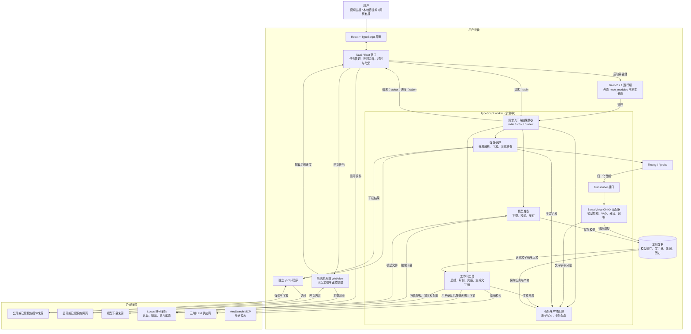
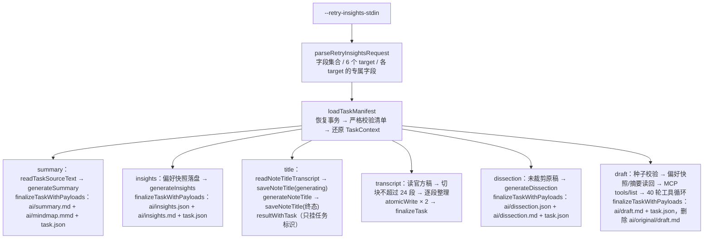

# TypeScript worker 目标架构

状态：待实施。当前生产版本使用 Python worker；本文件描述 TypeScript 重写后的目标架构和两版的差异。产品要求见 `docs/product-specs/2026-11-13-worker-typescript-rewrite.md`，实施与验收见 `docs/exec-plans/active/2026-11-13-worker-typescript-rewrite-plan.md`，ASR 适配细节见 `docs/design-docs/2026-11-13-typescript-worker-asr-boundary.md`。

## 架构图



## Python 版本与 TypeScript 方案

| 部分 | 当前 Python 版本 | TypeScript 目标方案 |
| --- | --- | --- |
| worker 进程 | Rust 启动 Python 运行期和 `worker_core`。 | Rust 启动随包 Deno `2.9.1` 运行 TypeScript worker；`node_modules` 与原生库外置。 |
| ASR | 默认使用 `funasr_onnx` 和 FSMN VAD，另有 PyTorch 模型选项。 | 只提供当前 ONNX 模型选项，`onnxruntime-node` 直接加载生产文件，通过 `Transcriber` 接口调用模型适配器。 |
| 模型扩展 | Python 已有 `Transcriber` 协议和模型注册。 | 保留模型无关的转写接口，后续模型通过适配器接入。 |
| 下载器 | worker 通过 Python 运行 `yt_dlp` 模块。 | 使用官方独立 yt-dlp 程序；它内置的 Python 是唯一获准的第三方例外。 |
| 工作间 | 使用 Python `agent_runtime`。 | 使用 TypeScript 工作间：官方 MCP SDK 客户端、`SKILL.md` 技能、计划工具与自建工具循环；计费、取消与网页来源待验证。 |
| 网页处理 | 系统 WebView 提取正文，Python worker 保存。 | 系统 WebView 继续提取正文，TypeScript worker 负责保存。 |
| 本地数据与云端 | 音视频、文字稿和历史保存在本机；用户确认后按功能调用云端 LLM。 | 保持相同边界，保留旧任务读取和恢复能力。 |

## 运行与数据边界

- Rust 继续拥有 worker 的启动、固定绝对超时、已验证进度空闲超时、取消和进程树终止；worker 使用受限 stdin 接收请求，通过 stdout 返回结构化结果，通过 stderr 报告进度与诊断。
- 用户提交已验证任务且所选模型缺失时才按需下载 ASR 模型；模型文件保存在当前数据根，安装包不内置 ASR 权重。现有 `<根>/models/onnx/` 缓存直接复用，沿用就绪标记、SHA-256 校验与原子提交。
- 平台字幕满足现有条件时沿用字幕流程；需要本地识别时，归一化音频经 `Transcriber` 进入 ONNX 适配器，统一产出文字稿及分段。产物、任务清单和恢复记录由任务管理模块写入。
- 工作间读取本地文字稿或网页正文，在用户确认后向 LLM 供应商发送对应功能所需内容。Locus 账号服务处理认证、额度和调用配置，不接收或保存用户的视频、音频、文字稿或工作间产物；草稿检索使用 AnySearch MCP。
- 升级时，旧 PyTorch 选择迁移到 ONNX 并提示用户，旧模型文件、组件和任务保留；数据位置迁移及中断恢复仍须维护旧资产完整性。

## 运行期与宿主接线

发行包里同时存在两代 worker，由资源是否齐全决定启动哪一代，宿主不需要编译期开关：

| 资产 | 位置 | 作用 |
|---|---|---|
| Deno 运行时 | `resources/bin/deno[.exe]` | 直接执行 `.ts`，不做 `deno compile` |
| yt-dlp | `resources/bin/yt-dlp.exe` 或 `yt-dlp_macos` | 固定版本 `2026.10.26`，安装时校验 SHA-256 |
| TS worker | `resources/worker-ts/{src,skills,deno.json,package.json,node_modules}` | `src/cli.ts` 是命令入口，`src/storage-validation-main.ts` 是存储校验入口 |
| Python worker | `resources/python` + `resources/worker` | 未重新打包的开发环境与尚未迁移的模式继续使用 |

- `runtime::worker_launch` 在四件资产（Deno、`src/cli.ts`、`deno.json`、`node_modules`）齐全时
  返回 `deno run --config <deno.json> --allow-read --allow-write --allow-ffi --allow-run
  --allow-net --allow-env <entry> <模式参数>`，否则返回 `python -m worker_core <模式参数>`。
  两种形态共用同一个 `WorkerLaunch::args` 拼装点，调用方只声明模式参数。
- Deno 分支注入 `DENO_DIR=<用户数据>/deno`、`DENO_NO_UPDATE_CHECK=1` 与
  `APP_YTDLP_PATH`（随包资产存在时），不注入任何 `PYTHON*`；两代 worker 都把随包 `bin/`
  放在 `PATH` 最前，ffmpeg、ffprobe 从那里解析，yt-dlp 由显式路径定位。
- 权限集是实测出来的最小集：去掉 `--allow-env` 会让任务存储读不到 `APP_*` 而以
  `TASK_STORAGE_UNAVAILABLE` 失败，去掉 `--allow-ffi` 让 ONNX 原生模块加载失败，
  去掉 `--allow-run` 让 ffprobe 无法启动。`--allow-run` 暂不按程序名收窄（`APP_YTDLP_PATH`
  可以是任意绝对路径）。
- `scripts/build-installer.mjs` 负责下载 ffmpeg/ffprobe、Deno 与固定版本的 yt-dlp，yt-dlp
  先校验 SHA-256 再落到 `resources/bin/`；`scripts/build-worker-ts.mjs` 负责组装与裁剪
  （`devDependencies`、`@types`、非目标平台的 `onnxruntime-node` 原生二进制都不进包），
  组装后立即用随包 Deno 跑一次 `--resolve-source-stdin` 并与协议结果逐字比较。
- 存储校验探针与 BYOK 探针走同一套解析，因此这两个入口在打包后也自动切到 Deno。

## 媒体准备

`worker-ts/src/media/` 负责把用户选中的文件变成任务可用的产物，对应
`worker/worker_core/{media,media_preparation}.py` 的本地分支：

- **命令执行**（`command.ts`）：`spawn` 直起进程、不经 shell，收集 stdout/stderr，超时返回
  `VIDEO_DOWNLOAD_TIMEOUT` 结构化结果而不是抛错；`structuredErrorCode` 从 stderr 前缀取码。
- **探测**（`ffprobe.ts`）：`ffprobe -of json` 解析出流类型、编码、采样参数、时长与体积；三组判定
  「有效音视频」「有效音频」「已是 16 kHz 单声道 PCM WAV」决定后续走哪条路。
- **归一化**（`audio.ts`）：`ffmpeg -vn -ac 1 -ar 16000 -c:a pcm_s16le`，参数逐字沿用生产——参数一改
  ASR 前端拿到的样本就变，识别文本随之变。
- **本地准备**（`local-media.ts`）：先把源文件分块复制到 cache 的 `download/`（用户随后挪动或删除原文件
  不影响任务），再探测、校验流类型，最后落 `media/video.<ext>` 与归一化后的 `media/audio.wav`；
  两个产物都走 staging + 探测校验 + 原子替换，失败不留半份文件。音频任务没有视频产物。
- **错误码是契约闭集**：`LOCAL_MEDIA_VALIDATION_FAILED`、`LOCAL_MEDIA_KIND_MISMATCH`、
  `LOCAL_VIDEO_STREAM_MISSING`、`LOCAL_VIDEO_AUDIO_STREAM_MISSING`、`LOCAL_AUDIO_STREAM_MISSING`、
  `LOCAL_VIDEO_COPY_FAILED`、`AUDIO_NORMALIZATION_FAILED`。前端按码给文案，不临时造新码。

流的判定只看「目标流是否存在」，因此**带音频的视频按「音频」处理是允许的**（与 Python 一致）：多一条
视频流不构成拒绝理由，扩展名与媒体类型的匹配由宿主在选文件时先挡一层。

## URL 下载器内核

`worker-ts/src/media/` 另有四个模块，对应 `worker_core/{media,subtitles,media_preparation}.py`
中不依赖平台网络行为的确定性部分：

- **命令与判定**（`ytdlp.ts`）：构造 yt-dlp 参数、判定 YouTube 链接与三平台 host 后缀、分类下载失败、
  清洗错误正文里的签名 URL 与 cookie 提示。命令前缀由调用方注入官方独立可执行文件路径；
  Python 的解释器模块入口按产品规格不再复用。参数、失败码与清洗结果由
  `scripts/tests/downloader-golden.py` 生成的基准逐项比对。
- **字幕解析**（`subtitles.ts`）：SRT/VTT 分块、语言优先序、滚动去重、标签与内联时间戳清洗；
  HTML5 实体解码交给 `entities@6.0.0`，不在仓库内复制标准库的实体表。
- **产物定位**（`download-output.ts`）：按修改时间、稳定 ID、下载 stdout 与快照差异定位视频文件；
  绝对路径必须落在下载目录内。音频复用判定复用 `ffprobe.ts`。
- **下载编排**（`download.ts`）：主路径调用 yt-dlp，字幕失败复用已下载媒体或以无字幕参数重试，
  可重试失败单次重试，三平台策略按顺序触发，小红书成功路径顺带探测字幕，结构化超时立即中断。
  策略的下载函数与字幕探测仍是可注入参数，生产装配已给出默认实现。

三平台传输层全部接通（`src/sources/{douyin,xiaohongshu,bilibili}/` + `src/download-reliability.ts`）。
URL 任务清单来源分支与「下载 → 字幕或 ASR → 清单」全链已接通，`--request-stdin` 已注册，
见下一节与「抖音传输层」「小红书传输层」「B 站传输层」。

## URL 任务管线

```text
--request-stdin（1 MiB stdin）
  └─ runProcessVideoOnce      解析三键请求 → resolveYtdlpLauncher → runUrlMediaPipeline
      └─ SourceResolver       直连识别 + xhslink / b23.tv / v.douyin.com 短链展开
          └─ createUrlTaskContext / ensureTaskDirs
              └─ prepareUrlMedia
                  ├─ downloadVideo（官方独立 yt-dlp；默认策略注册抖音与 B 站 fallback）
                  ├─ 四级定位 → ffprobe 校验 → 原子提交 media/video.mp4
                  ├─ 音频复用或 ffmpeg 归一化 → media/audio.wav
                  └─ findSubtitleTranscript（B 站 fallback 时跳过）
                      ├─ 有字幕：writeTranscriptFiles(subtitle) → subtitle.detect.found
                      └─ 无字幕：模型缓存 → Transcriber → writeTranscriptFiles(asr)
              └─ finalizeTask  artifacts 按磁盘现状重建 → 原子写 task.json
```

- 进度事件按 Python `_prepare_url` / `run_asr_transcript_stage` 的值与顺序发出：
  `18 → 34 → 48 → 58 → 58 → 68`，字幕分支以 `subtitle.detect.found(68)` 收尾。
  `10` 个媒体准备场景与 `13` 个语言标签规范化用例由
  `scripts/tests/url-media-golden.py` 从 Python 生产代码生成并逐项比对。
- 下载器可执行文件通过契约 `env.ytdlpPath=APP_YTDLP_PATH` 注入，回落到
  `<项目根>/bin/<平台资产名>`；缺失即固定 `VIDEO_DOWNLOAD_FAILED`，不回退系统 Python。
- 三平台 fallback 全部接通：`createFallbackStrategies` 只返回已提供的实现，
  `createPlatformFallbackStrategies()` 注册抖音、小红书与 B 站；后续平台仍可只注册一部分，
  未注册的平台不会出现「尝试过但失败」的假象。
- 小红书字幕探测默认指向真实实现（`downloadXiaohongshuSubtitle`），内部把网络与解析失败
  收敛成「没有字幕」；调用方仍可注入替身。
- 抖音传输层的模块划分与验收见下一节。
- 真实全链冒烟在 `worker-ts/tests/url-pipeline.test.mjs`：假 yt-dlp + 真实
  ffmpeg/ffprobe + 假转写器，覆盖 ASR 分支、字幕分支、下载失败与非法请求。

## 抖音传输层

`worker-ts/src/sources/douyin/` 复现 `worker_core/douyin/` 与 `douyin_fallback.py`，
`src/download-reliability.ts` 复现 `download_reliability.py`，供后续平台共用：

- **`source.ts`**：从分享文案或链接里取 AWEME ID（`modal_id` / `aweme_id` / `video|note` /
  `share/slides` 四种模式），取不到才跟随 `v.douyin.com` 短链；短链失败只淘汰该候选。
- **`page.ts`**：在 `window._ROUTER_DATA` 后按字符串感知的括号配对截出 JSON（对应 Python
  `raw_decode`），再深度优先找第一个 `videoInfoRes`；三种缺失各有固定错误文案。
- **`streams.ts`**：优先读 `bit_rate`（大小、宽高、档位名），缺省时按 1080p→360p 探测
  `play_addr.uri`（要求 206 + 合法 `Content-Range` + 媒体类型）；排序只看声明大小，
  同大小按档位名次序去重。
- **`transport.ts`**：`FetchDouyinHttpClient` 跟随重定向并保留最终 URL，按主机名记忆
  `Set-Cookie`；下载按 256 KB 分块、`Range` 续传、60 秒无进展由看门狗按 `DOWNLOAD_STALLED`
  掐断，保住 `.part` 供下一次尝试续传。
- **`fallback.ts`**：分享页 3 次重试 + 3–10 秒随机退避；候选按顺序下载，每候选两次尝试；
  字节进度按 8 MB 一档映射到 `30 + step`（最多 33）。
- **装配**：`createFallbackStrategies` 接受部分实现；`src/media/platform-strategies.ts`
  把 `DouyinFallbackError.code` 与 `BilibiliFallbackError.code` 原样映射成 stderr 的
  `CODE: 文案`。

验收：`scripts/tests/douyin-golden.py` 与 `scripts/tests/download-reliability-golden.py`
从 Python 生产代码生成基准；`worker-ts/tests/douyin.test.mjs` 逐项比对，
`worker-ts/tests/douyin-transport.test.mjs` 用本机 HTTP 服务验证 Cookie 透传、Range 续传
与停滞保留 `.part`，不触公网。

## B 站传输层

`worker-ts/src/sources/bilibili/` 复现 `worker_core/bilibili/` 与 `bilibili_fallback.py`：

- **`source.ts`**：纯 BV/av、普通视频链接与 `b23.tv` 短链（最多 5 层，`http` 失败换 `https`）；
  番剧/影视/课程/纪录片入口与非 `http(s)` scheme 明确拒绝；`p` 参数按 `int()` 语义取分 P。
- **`playback.ts`**：`view` 给分 P 与 cid，`playurl` 给 DASH 轨；选择按
  「编码偏好（AV1>HEVC>AVC）→ 带宽 → 像素 → 画质 id → 备用地址数」字典序比较，
  并列取先出现项；DRM 轨道在任何路径下都抛 `BILIBILI_DRM_PROTECTED`。
  401/403 与登录相关 `code`/文案统一归 `BILIBILI_LOGIN_REQUIRED`。
- **`transport.ts`**：`FetchBilibiliHttpClient` 正文按 4 MiB+1 截断读取；`fetch` 按
  `Accept-Encoding` 协商并在读取时解压，记录响应头前删掉 `Content-Encoding`，`decodeResponseBody`
  只为直接传入压缩正文的调用方保留解码分支；媒体流先看 `.part` 大小发 `Range`，
  服务端忽略续传时删部分文件重下一次。
- **`artifacts.ts`**：主备地址顺序下载；`ffmpeg -y -i video -i audio -c copy` 合并，
  非零退出或产物缺失即失败；临时 `.m4s` 与 `.merge.mp4` 必清，失败时保留已下载分片。
- **`fallback.ts`**：五条进度事件（22/26/30/32/34），阶段固定 `video_extracting`。
- **装配**：`platform-strategies.ts` 注册 B 站，合并复用主路径 runner
  （`FallbackDownloadContext.runner`）。

验收：`scripts/tests/bilibili-golden.py` 生成解析、选择、解码、合并与完整下载场景，
`worker-ts/tests/bilibili.test.mjs` 逐项比对；`worker-ts/tests/bilibili-transport.test.mjs`
用本机 HTTP 服务验证正文上限、Range 续传与忽略 Range 的回退。

## 小红书传输层

`worker-ts/src/sources/xiaohongshu/` 复现 `worker_core/xiaohongshu/` 与 `xiaohongshu_fallback.py`：

- **`url.ts`**：`urllib.parse` 语义的最小复刻。`new URL` 会把主机名小写化、丢尾随点，
  而 `source_url` 要写回用户原始输入；`parse_qs` 还会丢掉空值再取第一个。这两点必须保留。
- **`source.ts`**：笔记 ID 与链接解析、`xhslink.com`/`xhslink.cn` 短链最多 5 层、
  http 失败换 https、响应内嵌链接兜底；跳到外站或 `ftp` 时明确 `XHS_URL_INVALID`。
- **`page.ts`**：状态码映射、`fetch` 解压后的 10 MiB 上限（响应头里的 `Content-Encoding`
  在记录前删掉，避免二次解压）、`window.__INITIAL_STATE__` 的括号配对与 JS 字面量改写
  （`undefined`、`void 0`、末尾逗号）。
- **`streams.ts`**：候选流九元组打分与同画质去重；`int()` 按 Python 语义实现。
- **`subtitles.ts`**：`mediaV2` 解析、固定语言优先序、只接受小红书自家 https 字幕地址、
  后缀按 `format` 或 URL 推断。
- **`transport.ts`**：页面与媒体共用一个客户端（按主机记忆 Cookie）；视频 2 GiB / 120 秒无进展、
  字幕 2 MiB / 30 秒；Range 续传在服务端忽略时删部分文件重下一次。
- **`fallback.ts`**：候选有序尝试 + 尽力抓字幕；进度 22 → 30 → 重试 30，阶段固定
  `video_extracting`；字幕探测任何失败都返回「没有字幕」。
- **装配**：`platform-strategies.ts` 注册小红书，错误码原样映射成 `CODE: 文案`；
  URL 管线的字幕探测默认接真实实现。

验收：`scripts/tests/xiaohongshu-golden.py` 生成 22 个输入解析、8 个页面状态、9 个解码、
16 个初始状态与 JS 改写、8 组候选流、13 个字幕语言、9 个字幕选择、8 个完整下载与
4 个字幕探测场景，`worker-ts/tests/xiaohongshu.test.mjs` 逐项比对；
`worker-ts/tests/xiaohongshu-transport.test.mjs` 用本机 HTTP 服务验证 Cookie 透传、Range 续传、
忽略 Range 的重下、字幕主机白名单与停滞保留 `.part`。

## 协议入口

`worker-ts/src/protocol/` 与 `src/cli.ts` 复现宿主与 worker 之间的线协议，常量全部来自
`contracts/desktop-worker-contract.json`：

- **通道分工**：进度事件写 stderr 并带前缀（`APP_PROGRESS `、`APP_MODEL_DOWNLOAD `、
  `APP_DIAGNOSTIC `），终态结果写 stdout 且恰好一行 UTF-8 JSON，任何业务代码不得往 stdout 写别的。
- **退出码**：0 表示结果可用（`completed`），1 表示失败终态，2 表示用法错误（参数缺失、未知参数）。
  「用法错误不产生结果行」让宿主能区分「worker 没跑起来」和「跑了但任务失败」。
- **事件校验**：发之前按契约校验 `message_code`、`status`、`current_file` 约定与 `message_args`
  白名单，越界直接拒发；`current_file` 必须是安全 basename（无路径分隔符、无敏感词），避免把用户
  路径或凭据写进事件流。
- **stdin**：单次请求上限 1 MiB，先判长度再解码 UTF-8，非 JSON 对象一律视为非法请求，不做部分解析。
- **已迁移的模式**：`--download-asr-model --asr-model <id>`（只接受 `iic/SenseVoiceSmall-onnx`，
  模型根目录取 `APP_MODEL_DIR`）、`--process-local-media-stdin`（本地音视频 → 文字稿 → 清单）、
  `--retry-insights-stdin`（已转写任务 → 重新生成产物，见「重新生成入口」）与
  `--save-web-page-stdin --web-operation-id <uuid>`（网页抽取 → `article/` 两文件 + `schema_version=4`
  清单，`operation_id` 必须与命令行一致）。四条模式都经同一个 stdin 读取器（网页保存上限 40 MiB），
  业务失败写在结果行里、退出码仍是 0。另有 `--probe-llm-stdin`（BYOK 探针，
  `src/ai/llm-probe.ts`）：stdin 读四键闭集请求、发一次 `max_tokens=1` 的对话补全，输出裸的
  `{ok, error_code, latency_ms}` 一行、退出码恒 0，错误分类沿用生成路径的类型化错误映射；
  探针短路在配对校验之后、模式互斥之前，与 Python `cli.py` 分支次序一致。另有
  `--resolve-source-stdin`（`src/sources/`）：四平台闭集的来源身份识别，裸信封结果、
  stdin 失败退出 1 / 业务失败退出 0，与 Python 逐字段一致；三平台短链适配器
  （xhslink/b23.tv/v.douyin.com 展开引擎 + douyin 独立流程）也已落地，失败收敛 null 并
  保留直连错误，展开结果重过平台校验。
- **未迁移的模式**（`--request-stdin`、`--download-runtime-component`）尚未注册参数，
  传进来会得到用法错误而不是静默成功。结构化诊断事件（`APP_DIAGNOSTIC`）的分类规则也没有迁移，
  当前崩溃以明文堆栈写 stderr。

## AI 生成

`worker-ts/src/ai/` 分三层：调用层（凭证、请求、错误分类、工具循环）、生成层（提示词、输出语言、
分块、agent、产物写入）与检索工作间（`src/ai/workspace/`）。六条生成链全部实现；草稿链所需的
streamable-http MCP 客户端、技能渐进式披露与计划状态注入使用官方 SDK 与 `yaml`，不再依赖 Python
`agent_runtime`。

```text
resolveInsightLlmConfig ──┬─ BYOK：APP_LLM_* ─────────────┐
                          └─ 托管：checkout（每次调用一次）─┤→ chatCompletion（/chat/completions）
                                                            └→ runToolLoop（工具调用 → 交付完成）
```

- **凭证两条来源**：BYOK 直接读环境；托管在每次模型调用前用会话令牌换一次临时凭证，`request_id`
  带 `-call-NNNN` 后缀供服务端计量。输出预算 `APP_LLM_MAX_TOKENS` 在 checkout 之前校验——
  非法值不能等到扣完额度才发现。
- **请求形状以抓包为准**：Python SDK 实际发出的是
  `{"model","stream":false,"messages","tool_choice":"auto","tools","max_tokens"}`；
  这份请求已固化为 golden fixture，TypeScript 侧逐字段比对，`Authorization` 只出现在头里。
- **错误是闭集**：401/403 → `AI_LLM_KEY_REJECTED`，404 或 400-措辞指向模型 → `AI_LLM_MODEL_UNAVAILABLE`，
  429 → `AI_LLM_RATE_LIMITED`，超时 → `AI_LLM_REQUEST_TIMEOUT`，连接失败 → `AI_LLM_NETWORK_FAILED`，
  读不懂 → `AI_LLM_INVALID_RESPONSE`，其余 → `AI_LLM_REQUEST_FAILED`。分类只看状态码与措辞特征，
  供应商正文不进错误消息——它可能回显密钥片段。
- **工具循环只实现用到的能力**：多轮对话、function 调用、工具返回 `null` 即交付完成、轮间替换工具集
  （先 `submit_mindmap` 再 `submit_summary`）、空回复重试一次、轮数上限。SDK 的图片上下文、
  工具结果溢出文件、模型回退没有被任何 agent 使用，不移植。
- **生成层以 Python 渲染结果为基准**：三语语义表（`output-language.ts`）、分块（`transcript-chunks.ts`，
  按码点计长、给字节偏移与 `sha256`）、导图/摘要提示词（`prompts.ts`）都与 Python 逐字节/逐字段比对
  （golden fixture 在 `worker-ts/tests/fixtures/`）。这些内容用户能直接看到——提示词决定输出语言，
  分块偏移决定「来源片段」指向哪里——靠代码审阅看不出差异。
- **要点总结 agent**（`summary-agent.ts`）：一次运行两段交付。交出导图后换工具集并追加摘要任务，
  再交摘要即结束；非法导图会被退回重交（工具返回错误文本，循环继续），纯文本回复会被点名催促，
  6 轮上限后按缺失项报 `AI_INVALID_MINDMAP` / `AI_EMPTY_SUMMARY`。
- **产物写入**（`artifacts.ts`）：目标正好是任务内 `ai/` 时走多文件事务——摘要、导图、洞察 JSON
  与 Markdown、任务清单要么一起生效要么一起回滚；导出等其它目录逐文件原子写。
- **启发灵感**（`insights-agent.ts`、`preference-snapshot.ts`、`preference-options.ts`）：文字稿先按
  `MarkdownSplitter` 切块，模型只能用 `submit_insights` 交付，且 `sourceChunkId` 必须是本次真实存在
  的块 id；校验失败时工具返回错误文本让模型重交。偏好快照按 Python 的字段闭集严格解析，提示词、
  落盘文件与三语 Markdown 产物都用 Python 渲染的 golden 逐字节比对。
- **笔记标题**（`note-title.ts`、`tasks/note-title-metadata.ts`、`tasks/note-title-store.ts`）：按码点
  取 12000 字符的头/中/尾样本，单次 JSON 对象补全（无工具循环）；回复只接受恰好一个 `title` 键，
  重复键、控制/格式字符与英文超 10 词都判失败。标题状态机两次单事务写清单，不生成产物文件。
- **文字稿整理**（`transcript-polish.ts`、`pipeline/transcript-polish-step.ts`）：官方稿只读，
  `MarkdownSplitter(2000)` 切块、最多 24 段；每段带上一段末尾 200 码点做衔接，单次 system+user
  文本补全、空段退回原片段。整次整理只 checkout 一次临时凭证（24 段不能扣 24 次额度），
  未显式配置 `APP_LLM_MAX_TOKENS` 时不发 `max_tokens`。产物 `transcript/polished.txt` 与
  `polished.meta.json` 各做一次独立原子写，均不进事务闭集也不进清单 `artifacts`；元数据记原稿
  SHA-256 供桌面端判断整理稿是否过期。每段前发 `ai.generation.running`，`attempt` / `total`
  归一化到 1–100。系统提示词、切块、段提示词、摘要与元数据排版由 Python 生成的 golden 逐字节比对。

- **文字稿解剖**（`dissection-report.ts`、`dissection-agent.ts`）：模型通过 `submit_dissection`
  交付语义报告，闭集校验覆盖字段、文本长度、顺序段 id、来源块 id 与 `highlights` 的原稿逐字子串；
  不合规时工具返回带分类的反馈文本让模型重交，6 轮为限。来源摘要由 worker 按未裁剪的权威原稿
  算出，`parsePersistedDissection` 读回时用当前原稿重算并比对整份文件，原稿变更即判定旧报告过期。
  三语 Markdown 与 JSON 产物字节由 Python 生成的 golden 逐字节比对，两个文件与清单进同一事务。
  每次模型请求前发 `ai.generation.running`（attempt/total 固定 6）。

## 重新生成入口

`src/protocol/retry-request.ts`、`src/tasks/{load,source-file,source-text,note-title-metadata,note-title-store,existing-artifacts}.ts`、
`src/ai/workspace/` 与 `src/pipeline/insight-retry.ts` 复现 `worker_application/insight_retry.py`
的六个分支：



- **读比写严**：任务 id 必须是单层目录名；任务目录与清单不能是链接、清单 `nlink=1`；realpath 必须仍在
  `<output>/tasks` 内；先恢复残留事务再读；最后校验 `schema_version`、来源、标题元数据与 `artifacts` 闭集。
  权威源文本还要求清单里的 `transcript_txt` 指向固定路径，读取前后比对 inode/长度/修改时间。
- **六个 target 全部可用**：`IMPLEMENTED_RETRY_TARGETS` 直接等于契约的
  `RETRY_TARGETS`，临时码 `INSIGHT_TARGET_UNSUPPORTED` 已删除。托管 checkout 的
  `request_id` 按 target 加后缀（`insight_target_env`）。`title` 是单次 JSON 文本补全（无工具循环），
  不产生产物文件，因此走下面单独的清单状态机；`transcript` 的两份产物不在事务闭集里，
  走两次独立原子写 + 清单单独提交；`draft` 在读取权威文字稿之前派发，只读 `ai/` 下的种子、
  偏好快照与摘要，整次成稿只 checkout 一次凭证。
- **一次提交**：`summary` / `insights` / `dissection` 的产物与清单进同一事务，避免「文件新、
  清单旧」；`artifacts` 先按事务闭集补上 payload 路径再序列化。已有洞察、摘要、解剖报告从磁盘
  读回合并，`insights_count` / `note_title` / `draft_seed_insight_id` 不因只重算一项而丢失。
  读回解剖报告时用当前原稿重算来源摘要，篡改过或已过期的文件按「没有报告」处理。
- **两类例外**：`title` 只就地改清单的 `note_title` / `updated_at`（两次单事务），结果不重写整份
  清单；`transcript` 的 `polished.txt` / `polished.meta.json` 用两次独立原子写（与 Python 的
  `atomic_write_text` 一致），清单再由 `finalizeTask` 提交。两者都不把新文件塞进 `artifacts`，
  因为事务闭集与清单键表里没有这些路径，硬塞会让 `task.json` 指向一个没有键的文件。
- **标题状态机**：`title` 复现 `run_note_title_step`，只读权威稿、就地改清单里的 `note_title` 与
  `updated_at`，用两次单事务写 `generating` 与 `completed` / `failed`，并在 stderr 发
  `title.generation.running` / `title.generation.completed`。结果只挂 `task_id` / `task_dir` /
  `artifacts`，清单 `status` 与前端写入的未知字段都不动；失败码落在 `note_title.error_code`，
  旧标题文字保留在 `text` 里。生成、落盘、读清单共用 `tasks/note-title-metadata.ts` 一份校验规则。
- **失败留痕**：`summary` / `insights` / `transcript` / `dissection` / `draft` 在任务打开后的失败
  （源文本不可用、生成失败）都在 `task.json` 写 `status=partial_completed` 与
  `error{code,message,stage}`；`draft` 的阶段是 `draft_generating`，其余是 `insights_generating`。
  只有请求非法、任务读不出来时结果不带 `task_id`。`title` 的失败状态只在 `note_title` 里留痕，
  结果行的阶段是 `title_generating`，清单 `status` 不变。
- **检索工作间**：`src/ai/workspace/mcp-client.ts` 用官方 `@modelcontextprotocol/sdk` 连
  anysearch 的 streamable-http 端点，`tools/list` 返回的工具按服务端顺序放在工具集最前面；
  `skills.ts` 用 `yaml` 解析随包 `worker-ts/skills/viral-writer/SKILL.md` 的 frontmatter，
  生成技能清单与 `Skill` 工具；`planning.ts` 复现 `write_todos`、计划状态与最多两次完成否决。
  两个 hook 通过 `onChatRequest` 用各自的注释哨兵整段替换 system 消息，不随轮数累积。
  `submit_draft` 是唯一正文写入面；模型、MCP 与 checkout 的异常统一收敛成
  `DRAFT_GENERATION_FAILED`，不把供应商正文带进结果行。
- 与 Python 的已知差异：`validateInsightsDelivery` 的重复话题判定用 `toLowerCase()` 近似 `casefold()`；
  解剖的进度 `attempt` 在超过 6 次请求时封顶，避免契约校验拒止整个事件；MCP `content` 块按文本
  拼接成 tool 消息（纯文本检索结果等价）；不读项目根的 `.env`。

## 任务存储与本地任务管线

`worker-ts/src/tasks/` 与 `worker-ts/src/pipeline/local-media.ts` 复现
`worker_core/task_store.py` 与 `pipeline_runtime/orchestration.py` 的本地管线。
同一套任务存储现在还有网页（`web_page`）与 URL（`url`）两种来源，下面先说已接通的本地管线：

```text
--process-local-media-stdin
  └─ parseProcessLocalMediaRequest  契约字段/绝对路径/扩展名三处自洽
      └─ createLocalTaskContext     <output>/tasks/<YYYYMMDD>-<HHMMSS>-local-<hex>
          └─ prepareLocalMedia      <cache>/tasks/<id>/download → media/{video.<ext>,audio.wav}
              └─ Transcriber        真实 ONNX 或注入的假转写器
                  └─ writeTranscriptFiles   transcript/{txt,md,segments.json}
                      └─ finalizeTask       按磁盘现状重建 artifacts，原子写 task.json
```

- `tasks/paths.ts` 是目录布局的唯一来源：产物在 `<output>/tasks/<id>`（`media/`、`transcript/`、`ai/`），
  源文件副本在 `<cache>/tasks/<id>/download/`；副本只在准备期存在，成功或失败都会清掉，与 Python 一致。
- `tasks/manifest.ts` 生成 `task.json`：字段集合与顺序、`schema_version=3`、
  `source_privacy_migration_version=2`、`local_source`、`platform="local"`、`text_preview`（按码点截断
  180）、`draft_seed_insight_id` 三态（沿用/清空/写入）、`note_title` 保留，全部按 Python 的
  `serialize_task_manifest`；`artifacts` 在写之前先过闭集校验，写进去就代表「这个键对应这个文件」。
- `tasks/index.ts` 的 `finalizeTask` 顺序是：恢复残留事务 → 按 `lstat` 现状重建 `artifacts`（链接与
  目录联接都排除）→ 原子写清单。失败也走这条路：`status=failed` 的清单同样带 `error{code,message,stage}`。
- `pipeline/local-media.ts` 只做编排，不改语义：进度事件的值与顺序（18/34/58/58/68）、失败阶段
  （媒体期 `video_extracting`、识别期 `video_transcribing`）、错误码映射都与 Python 相同。PyTorch 模型
  标识在这里明确返回 `ASR_MODEL_UNSUPPORTED`，不去假装能加载它——新版本没有那条路径。
- 两个注入点：`transcriberFactory` 与 `modelCacheValidator`。前者让单测用假转写器验证接线，后者让
  「模型已就绪」之后的分支不必真的下载 460 MB 模型。

### URL 来源的任务身份

`createUrlTaskContext` 与 URL 分支的清单序列化/读回先于下载管线落地，因为 `task.json` 是宿主、
Python 与 TypeScript 共读的持久化状态，不能等接线时再改格式：

```text
identifySource(url)
  └─ canonicalUrlForPersistence   重新验算规范 URL，token 与篡改 ID 在此被拒
      └─ createUrlTaskContext      <YYYYMMDD>-<HHMMSS>-<平台>-<稳定 ID>[-p<分P>]
          └─ serializeTaskManifest source_url / source_identity / platform（不写 source_kind）
              └─ readTaskSource    身份重新验算 + source_url 相等 + 排除 local_source/web_source
```

- 稳定 ID 上限 80 字符，分 P 后缀先占位；当前四平台 ID 上限 24 位，截断分支只是守住目录名长度。
- URL 清单**不写 `source_kind`**（Python 也不写）；读回时缺失、`null` 与显式 `"url"` 都按 URL 处理，
  老清单因此能继续打开。URL 任务允许 `note_title`，产物路径用默认 `media/video.mp4`。
- 跨语言基准由 `scripts/tests/url-task-golden.py` 从 Python 生产代码生成：5 组身份的完整清单文本
  逐字节比对，20 个来源字段正反例逐用例比对。

## 产物写入

产物写入落在 `worker-ts/src/artifacts/`，沿用现有原子提交与事务恢复规则，不重新设计存储格式：

- `atomic-file.ts`：同目录 staging → fsync → 目标校验 → `rename` → 目录 fsync。失败一律收敛成不含
  路径的 `AtomicFileCommitError`（异常消息会进日志，不能带用户路径）。目标或其父目录是符号链接时拒止；
  Node 的 `lstat` 把 Windows 目录联接报成 `isSymbolicLink()`，与符号链接同一条拒绝路径（Python 侧用
  `st_file_attributes` 判重解析点，两者覆盖范围在目录联接与符号链接上一致）。
- `task-transaction.ts`：一次提交替换最多 8 个闭集目标，先写 staging 与 rollback 材料，再落
  `state=prepared` 的 journal，逐项替换，最后落 `state=committed`。journal 落盘即提交点：
  `prepared` 恢复必须回滚，`committed` 恢复只清理材料；回滚材料先全部读齐再动手，缺一份就整体拒绝，
  不会「恢复一半」。残留清理只认闭集名字（`.artifact-<32 hex>-<0..7>.{staging,rollback}` 与
  `.artifact-transaction.<32 hex>.part.json`），不动别人的文件。
- `transcript-artifacts.ts`：`transcript.txt` / `transcript.md` / `segments.json` 的文件名、Markdown
  结构与平台换行（产物文件给人看，Windows 用 CRLF）与 Python 一致；没有分段时删掉旧 `segments.json`
  而不是留一份过期分段。目标正好是任务目录下的 `transcript/` 时改走多文件事务，让三份产物与清单同生
  共死；导出、诊断等其他目录逐文件原子写。
- 契约：目的地闭集、journal 字段、内部文件名与提交顺序以 `contracts/task-artifact-transaction-v1.json`
  为准，三份实现（Python、TypeScript、Rust）互读同一个 journal，任何一方放宽都会让另两方把不可信状态
  当成已提交。单测直接对契约里的正反例断言，并逐项比对目的地集合。
- 与 Python 的两处已知差异，均不影响互读：① `JSON.parse` 对重复键取后者，Python 的 `_closed_object`
  直接拒止——重复键只能来自手工篡改，解析后的结果仍须通过全部严格校验；② `writeSyncedNewFile` 在
  目标已存在时只清理「本次自己创建」的文件，Python 会删掉已存在的文件（材料名带 uuid，实际不会撞名）。

## 待验证事项

- 运行期采用安装包已锁定的 Deno `2.9.1`。2026-11-14 在 Windows x64 验证：`onnxruntime-node@1.29.0` 原生插件可加载，零张量数值与 8 条端到端文本与 Node 完全一致；启动参数为 `--allow-read --allow-write --allow-ffi --allow-run --allow-net --allow-env`（逐项去掉的失败码见「运行期与宿主接线」），`node_modules` 由 `deno.json` 的 `nodeModulesDir: "manual"` 解析；`deno compile` 单文件会回退到系统旧版 `onnxruntime.dll`，不使用。组装后的运行时 46.8 MB，已在 Windows x64 跑通整条本地媒体管线。macOS 的原生依赖待验证；`onnxruntime-node@1.29.0` 不提供 `darwin/x64`，macOS Intel 需另定版本策略。
- `onnxruntime-node@1.29.0` 直接加载生产 `model_quant.onnx` 与 FSMN VAD ONNX。Python 与 Node 两侧的加载、推理、CTC 解码、ASR 前端、FSMN VAD 缓存传递、状态机、VAD 在线前端跨块特征与分段时间戳已逐项比对通过；端到端原型已跑通分段、切片与 `Transcript` 组装，文本存在前端浮点级差异，已按 CER 门槛与 Paraformer 独立参考在 8 条真实窗口实测通过（增量 `−0.159pp`，门槛 `0.5pp`）。ASR 接口与唯一适配器已落地在 `worker-ts/src/asr/`，门禁 `scripts/asr-verification/` 直接跑这套生产代码；三平台原生依赖打包仍待验证。
- URL 下载器内核已落地在 `worker-ts/src/media/{ytdlp,subtitles,download-output,download}.ts`：命令参数、
  YouTube 判定与失败分类、字幕解析、产物定位与下载编排均有 Python 生产源码生成的跨语言基准；真实官方
  `yt-dlp.exe` 进程下载一条 788493 字节的公开 mp4 成功。URL 任务管线与三平台传输层已全部接入，
  2026-11-16 的三平台真实公网冒烟显示：B 站与带分享令牌的小红书两侧产物逐字节相同，
  抖音两侧同为间歇可用；不带 `xsec_token` 的小红书链接两侧同为 `XHS_NOTE_NOT_FOUND`，
  详见 gaps「真实公网冒烟结果」。
- 媒体准备已落地在 `worker-ts/src/media/`：真实 ffmpeg 生成的 44.1 kHz 立体声 WAV 与 120p MP4 均能被
  归一化成 16 kHz 单声道 PCM WAV 并原子落盘，产物可直接喂给真实转写器；错误码与流校验按契约实测，
  已接入本地任务管线（`--process-local-media-stdin`）。
- 协议入口已落地在 `worker-ts/src/protocol/` 与 `src/cli.ts`：前缀、契约版本、进度事件表与
  `contracts/desktop-worker-contract.json`、Python 进度注册表逐项比对；`--download-asr-model` 与
  `--process-local-media-stdin` 与 `--retry-insights-stdin` 均已在真实环境下跑通
  （stderr 事件 + stdout 单行结果 + 退出码），stdin 上限与非法输入语义按 Python 实现。
  六个 stdin 模式与 `--download-asr-model` 均已注册并跑通；结构化诊断事件仍由 Rust 侧从 stderr 汇总。
- 产物写入已落地在 `worker-ts/src/artifacts/`：原子文件、多文件事务与文字稿产物均有单测，并用崩溃注入
  验证回滚与提交后清理；与 Python 双向互读 journal 的实测见执行计划。`task.json` 的内容构造已随任务
  存储落地，TypeScript 写出的清单可被 Python 的 `load_task_manifest` 完整读回，反之亦然。
- 「本地文件 → 文字稿 → 清单」与「已转写任务 → 导图 + 摘要 / 启发灵感 / 笔记标题 / 整理稿 /
  解剖报告 / 成稿」都已端到端跑通（前者用真实 ffmpeg + 真实 ONNX 模型、识别文本与门禁 golden
  逐字相同；后者用真实 CLI + 本地假 OpenAI 服务，产物、`note_title`、解剖报告与成稿被 Python
  严格读回；草稿链另用 Python 官方 `mcp` 包起的真实 streamable-http 端点验证协议往返）。AI 侧的
  提示词、分块、三语输出、偏好词表、标题采样、整理稿元数据、解剖报告字节、草稿工具 schema 与
  产物事务均与 Python 逐字节一致；`--retry-insights-stdin` 的六个 target 全部可用。
  网页任务也已端到端跑通：URL 规范化与保存契约由 Python 生成的 golden 逐字节对齐（66 例），
  `--save-web-page-stdin` 与 `--retry-insights-stdin` 的网页来源分支经双向 CLI 冒烟
  （`work/interop/web-page-cli-smoke.mjs`：TS 保存 → Python 严格读回；Python 保存 → TS 重算摘要
  → Python 再读回，提示词按 `saved web article` 变体发送）。
  存储校验探针（数据位置迁移的基线采集与核验）也已落地：独立脚本入口，组件状态矩阵与
  就绪模型统计与 Python 探针逐字节一致（双向 CLI 冒烟），`--import-component` 按计划第 6 条
  不再导入 PyTorch、如实按不可用收敛。
  仍未开始：URL 下载器与平台解析、工作间的计费/取消验证（真实托管 checkout 的扣费边界）、
  宿主侧从 Python 切换到 TypeScript worker 的接线。
- TypeScript 工作间的 MCP 检索客户端、技能与计划已用真实端点验证；仍须覆盖托管 checkout 与
  BYOK 的计费边界、进程树取消与错误语义；官方独立 yt-dlp 还须核实三平台资产、完整性与许可。
