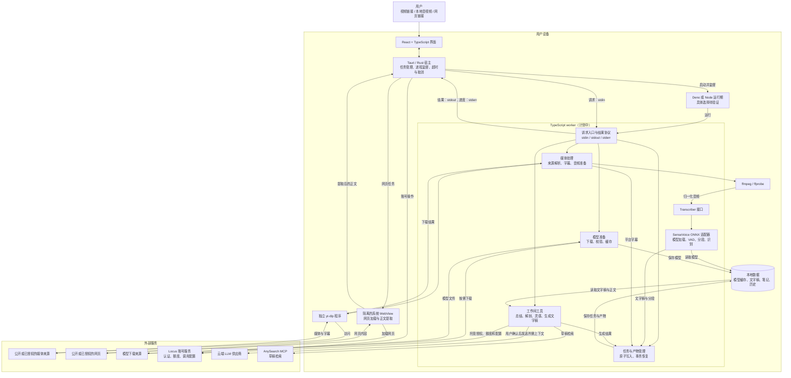

# TypeScript worker 目标架构

状态：待实施。当前生产版本使用 Python worker；本文件描述 TypeScript 重写后的目标架构和两版的差异。产品要求见 `docs/product-specs/2026-11-13-worker-typescript-rewrite.md`，实施与验收见 `docs/exec-plans/active/2026-11-13-worker-typescript-rewrite-plan.md`，ASR 适配细节见 `docs/design-docs/2026-11-13-typescript-worker-asr-boundary.md`。

## 架构图

## Python 版本与 TypeScript 方案

| 部分 | 当前 Python 版本 | TypeScript 目标方案 |
| --- | --- | --- |
| worker 进程 | Rust 启动 Python 运行期和 `worker_core`。 | Rust 启动 TypeScript worker；Deno 与 Node 的选择待验证。 |
| ASR | 默认使用 `funasr_onnx` 和 FSMN VAD，另有 PyTorch 模型选项。 | 只提供当前 ONNX 模型选项，通过 `Transcriber` 接口调用模型适配器。 |
| 模型扩展 | Python 已有 `Transcriber` 协议和模型注册。 | 保留模型无关的转写接口，后续模型通过适配器接入。 |
| 下载器 | worker 通过 Python 运行 `yt_dlp` 模块。 | 使用官方独立 yt-dlp 程序；它内置的 Python 是唯一获准的第三方例外。 |
| 工作间 | 使用 Python `agent_runtime`。 | 使用 TypeScript 工作间实现，具体运行器依赖待验证。 |
| 网页处理 | 系统 WebView 提取正文，Python worker 保存。 | 系统 WebView 继续提取正文，TypeScript worker 负责保存。 |
| 本地数据与云端 | 音视频、文字稿和历史保存在本机；用户确认后按功能调用云端 LLM。 | 保持相同边界，保留旧任务读取和恢复能力。 |

## 运行与数据边界

- Rust 继续拥有 worker 的启动、固定绝对超时、已验证进度空闲超时、取消和进程树终止；worker 使用受限 stdin 接收请求，通过 stdout 返回结构化结果，通过 stderr 报告进度与诊断。
- 用户提交已验证任务且所选模型缺失时才按需下载 ASR 模型；模型文件保存在当前数据根，安装包不内置 ASR 权重。已有模型缓存是否可复用由文件兼容性和完整性决定。
- 平台字幕满足现有条件时沿用字幕流程；需要本地识别时，归一化音频经 `Transcriber` 进入 ONNX 适配器，统一产出文字稿及分段。产物、任务清单和恢复记录由任务管理模块写入。
- 工作间读取本地文字稿或网页正文，在用户确认后向 LLM 供应商发送对应功能所需内容。Locus 账号服务处理认证、额度和调用配置，不接收或保存用户的视频、音频、文字稿或工作间产物；草稿检索使用 AnySearch MCP。
- 升级时，旧 PyTorch 选择迁移到 ONNX 并提示用户，旧模型文件、组件和任务保留；数据位置迁移及中断恢复仍须维护旧资产完整性。

## 待验证事项

- 现有安装包包含 Deno，尚需验证其对所需原生依赖及三平台打包的支持；运行期选择以 `docs/exec-plans/active/2026-11-13-worker-typescript-rewrite-plan.md` 的验证结果为准。
- `sherpa-onnx-node`、SenseVoice ONNX 导出文件与 Silero VAD 已完成可行性测量。实验模型文件与生产 ONNX 文件哈希不同；生产文件的加载兼容、分段质量、性能和正式安装包仍需验证。
- TypeScript 工作间运行器须覆盖现有工具调用、MCP、结账、BYOK、取消和错误语义；官方独立 yt-dlp 还须核实三平台资产、完整性与许可。
